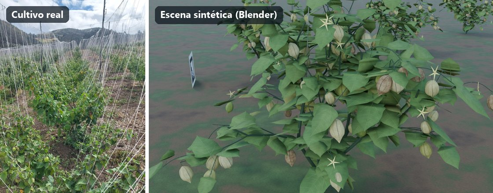
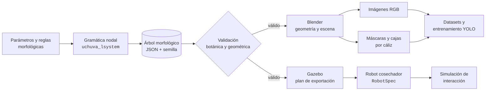
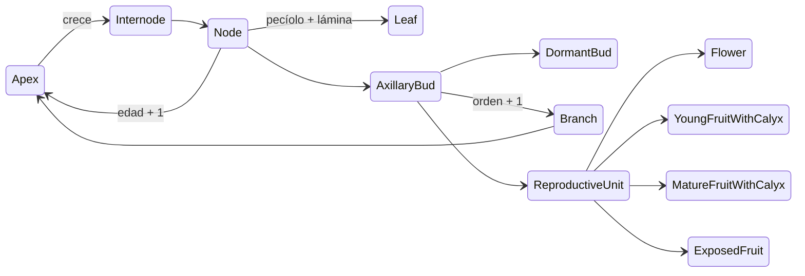
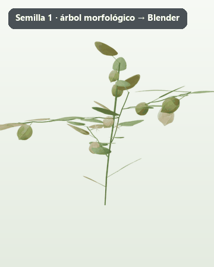
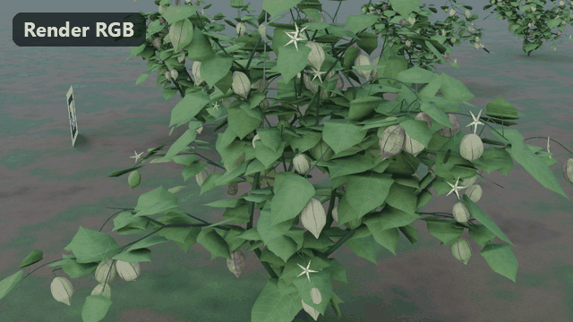
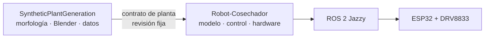
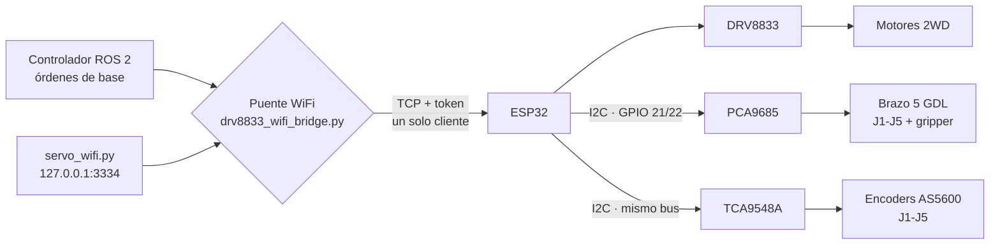
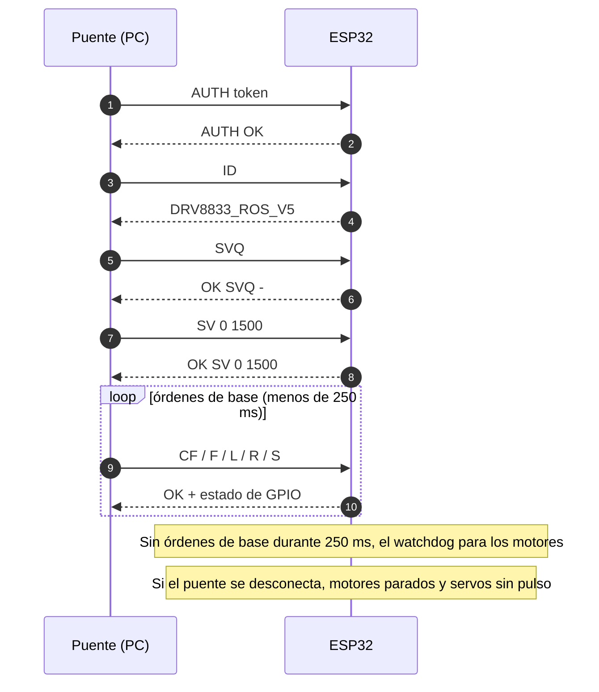

<div align="center">

# SyntheticPlantGeneration

### Morfología procedural de uchuva, visión artificial y simulación robótica

[](README_TECHNICAL.md#entorno-python)
[](docs/guides/generador_actual_y_contrato_gazebo.md)
[](docs/guides/integracion_physalisharvest.md)
[](https://github.com/dryanguasr/Robot-Cosechador)
[](docs/guides/esp32_wifi.md)
[](requirements.txt)
[](LICENSE)

[Arquitectura](docs/README.md) · [Resultados](docs/reports/indice_resultados_experimentales.md) · [Guías](docs/guides/) · [Documentación técnica](README_TECHNICAL.md)



</div>

---

## Contenido

- [Qué es](#qué-es)
- [Cómo funciona](#cómo-funciona)
- [Galería](#galería)
- [Inicio rápido](#inicio-rápido)
- [Resultados](#resultados)
- [Robot cosechador](#robot-cosechador)
- [Estructura del repositorio](#estructura-del-repositorio)
- [Guías](#guías)
- [Procedencia, licencia y citación](#procedencia-licencia-y-citación)

## Qué es

Plataforma de investigación sobre **uchuva (*Physalis peruviana*)**, datos
sintéticos y percepción para robótica agrícola. La planta se describe como un
**árbol morfológico serializable**: ejes, nodos, hojas, yemas axilares y
unidades reproductivas con su cáliz (capacho). Blender y Gazebo interpretan ese
árbol, sin redefinir la botánica, para producir imágenes, máscaras y escenarios
de interacción con un robot.

> [!IMPORTANT]
> **Corte documental: 24 de noviembre de 2026.** Los informes conservan
> resultados negativos y pendientes. La transferencia al cultivo real, la
> madurez del fruto oculto y la cosecha autónoma con percepción desplegable
> **siguen sin demostrarse**.

> [!NOTE]
> **Organización actualizada el 25 de noviembre de 2026:** el desarrollo del
> cosechador, su hardware y su integración se centraliza en
> [Robot-Cosechador](https://github.com/dryanguasr/Robot-Cosechador). Este
> repositorio conserva la generación sintética y el contrato de plantas; las
> fuentes históricas del robot quedan para reproducir los experimentos
> anteriores. [Responsabilidades y enlace entre repositorios](docs/architecture/separacion_robot_cosechador.md).

## Cómo funciona



Cada planta se reproduce con su semilla. El JSON exportado registra la versión
del script, la semilla y el preset de parámetros. La validación distingue
**colisión geométrica** (físicamente inválida), **oclusión visual** (útil para
datos sintéticos) y **morfología fuera de rango** (botánicamente sospechosa).

<details>
<summary><b>Gramática conceptual de la planta</b></summary>



Las hojas y los frutos se anclan siempre a un nodo o axila, nunca a
coordenadas globales arbitrarias. La gramática se implementa de forma
procedural; no es un motor formal de reescritura de cadenas.

</details>

### Tres frentes

| Frente | Código principal | Alcance documentado |
| --- | --- | --- |
| 🌱 Morfología y generación sintética | [`src/uchuva_lsystem/`](src/uchuva_lsystem/) | Plantas nodales, escenas de cultivo, anotaciones, apariencia y validación geométrica |
| 👁️ Aumentación y percepción | [`src/uchuva_classical_augmentation/`](src/uchuva_classical_augmentation/), [`src/uchuva_annotation_audit/`](src/uchuva_annotation_audit/) | Baselines, pilotos de detección y máscaras, aplicación de revisión y protocolos humanos |
| 🤖 Puente y simulación de cultivo | [`src/uchuva_gazebo/`](src/uchuva_gazebo/) | Contratos de plantas, captura y localización; desarrollo del cosechador en Robot-Cosechador |

La [documentación técnica](README_TECHNICAL.md) cubre también la
reconstrucción desde vídeo real, la aplicación Android, el equipo y la
organización del código.

## Galería

<table>
  <tr>
    <td width="40%" align="center">
      <br>
      <sub><b>Planta procedural, semilla 1.</b> Árbol morfológico interpretado en Blender: eje principal, ramas, hojas, flores y cálices.</sub>
    </td>
    <td width="60%" align="center">
      <br>
      <sub><b>Del render a la anotación.</b> Cada cáliz recibe su máscara automáticamente. Cian: Pintona · amarillo: Madura · violeta: Sobremadura.</sub>
    </td>
  </tr>
</table>

> [!NOTE]
> Pintona, Madura y Sobremadura describen la **apariencia del capacho**, no la
> madurez agronómica demostrada del fruto interno.

## Inicio rápido

**Requisitos:** Python 3.11 o posterior. El núcleo morfológico no necesita
paquetes externos, Blender ni Gazebo.

```powershell
# 1. Clonar en una ruta corta (algunas rutas superan los 200 caracteres en Windows)
git clone https://github.com/dryanguasr/SyntheticPlantGeneration C:\src\SyntheticPlantGeneration
cd C:\src\SyntheticPlantGeneration

# 2. Generar una planta y su informe de validación (solo biblioteca estándar)
python scripts/generate_morphology_tree.py --seed 1
python scripts/validate_repository_context_graph.py
```

El primer comando escribe `outputs/specs/morphology_tree_seed_1.json` y
`validation_report_seed_1.json`.

<details>
<summary><b>Suite de pruebas completa</b> (visión y entrenamiento)</summary>

```powershell
py -3.12 -m venv .venv
.\.venv\Scripts\python -m pip install -r requirements.txt
$env:PYTHONPATH = Join-Path (Get-Location) 'src'
.\.venv\Scripts\python -m unittest discover -s tests -v
```

Ultralytics queda fijada en **8.4.114**, la versión de todos los informes,
porque el emparejamiento de predicciones de AP cambia entre versiones. Para
GPU, instala antes la variante de Torch adecuada desde
[pytorch.org](https://pytorch.org/get-started/locally/).
[Detalle del entorno](README_TECHNICAL.md#entorno-python).

</details>

<details>
<summary><b>Planta en Blender</b></summary>

```powershell
& "C:\Program Files\Blender Foundation\Blender 5.2\blender.exe" --background `
  --python scripts/generate_blender_single_plant_preview.py -- --seed 1
```

Escribe `outputs/blends/uchuva_lsystem_seed_1.blend`. Las escenas multiplanta
y las campañas de dataset tienen sus propias guías y tiempos de cómputo
largos; consúltalas antes de lanzarlas.

</details>

## Resultados

| Línea | Resultado al corte | Estado |
| --- | --- | --- |
| [Aumentación clásica v2](docs/reports/aumento_clasico_v2_confirmatory_2026-08-28.md) | 40 corridas confirmatorias válidas; ninguna receta superó todos los criterios operativos predeclarados | ❌ Sin receta promovida |
| [Generación espacial](docs/reports/resultados_pilotos_deteccion_y_generacion_2026-11-24.md) | 20 plantas admitidas; primer corte de 144 pares completos; continuación pausada con 503 vistas frente a la meta de 1.000 | ⏸️ Pausada |
| [Segmentación de noviembre](docs/reports/resultados_segmentacion_privada_2026-11-24.md) | Dos estudios de 18 corridas. El brazo de 240 exposiciones sintéticas mejoró 1,42 puntos de AP macro de máscaras en desarrollo histórico frente a su control real | 🔶 Preliminar |
| [Cosechador V8](docs/reports/piloto_cad_v8_canasta_2026-11-24.md) | Nueve depósitos observados en una toma continua con movimiento prescrito; diagnóstico RGB con 0/6 coincidencias | 🔶 Demostración |

<details>
<summary><b>Límites de cada resultado</b></summary>

- **Generación espacial:** las vistas repetidas no son plantas biológicamente
  independientes.
- **Segmentación:** las referencias de entrenamiento son máscaras
  provisionales revisadas por el asistente; la adjudicación humana y la
  evaluación externa siguen pendientes.
- **Cosechador V8:** se omitió la respuesta de contacto del brazo, el chasis
  y el cultivo; sí se simularon la caída de los frutos liberados y sus
  contactos con la canasta. La admisión por fuerzas sigue pendiente.
- AP de cajas, AP de máscaras, seguimiento y errores métricos 3D corresponden
  a protocolos distintos y no son comparables entre sí.

</details>

El [índice experimental](docs/reports/indice_resultados_experimentales.md)
distingue campañas cerradas, exploratorias y bloqueadas.

## Robot cosechador

La implementación vigente del robot, su hardware y el control del ESP32 están en
[`Robot-Cosechador/src/uchuva_robot`](https://github.com/dryanguasr/Robot-Cosechador/tree/main/src/uchuva_robot).
Ese repositorio enlaza una revisión fija de este generador, que solo le entrega
plantas con unidades, semilla, preset, identidades y hashes explícitos.



Los módulos del robot conservados aquí (`RobotSpec`, perfiles,
`gazebo/harvest_system/`) y el snapshot atribuido de
[PhysalisHarvest](https://github.com/amayadiegoalejandro05/PhysalisHarvest), de
Diego Amaya, corresponden al **corte histórico de integración** y se mantienen
para reproducir los experimentos registrados.

### ESP32 por WiFi: motores y servos

El ESP32 del banco se controla por WiFi en lugar de USB. Una sola conexión TCP
autenticada lleva las órdenes de los motores de la base (DRV8833, firmware
original de Diego sin cambios) y de los servos del **brazo de 5 GDL** por una
placa **PCA9685** (I2C).



```powershell
python scripts/drv8833_wifi_bridge.py --host 192.168.4.1 --solo-servos
```

```powershell
python scripts/servo_wifi.py J2 1500
```

| Articulación | Función | Actuador documentado | Canal |
| --- | --- | --- | --- |
| J1 `base` | Giro de la base (Yaw) | RDS3235-270 | 0 |
| J2 `hombro` | Hombro (Pitch) | ASME-03B | 1 |
| J3 `codo` | Codo (Pitch) | ASME-MRA-110KG | 2 |
| J4 `muneca_roll` | Muñeca (Roll) | TD-8135MG-180 | 3 |
| J5 `muneca_pitch` | Muñeca (Pitch) | TD-8135MG-180 | 4 |
| gripper `pinza` | Apertura y cierre | TD-8135MG-180 (por confirmar) | 5 |

| Orden | Efecto |
| --- | --- |
| `servo_wifi.py <articulación> <us>` | Lleva la articulación (nombre, alias o canal) al pulso indicado |
| `servo_wifi.py estado` | Posición actual y objetivo de cada articulación activa |
| `servo_wifi.py off` | Corta el pulso de todos los servos |
| `servo_wifi.py encoders` | Ángulo del imán de los AS5600 de J1-J5 y estado de cada imán |
| `servo_wifi.py mapa` | Muestra articulaciones, canales, rangos y velocidades |

- **Mapa del brazo** en [`configs/robots/brazo_5gdl_servos.json`](configs/robots/brazo_5gdl_servos.json),
  tomado de la [configuración documentada](docs/references/configuracion_brazo_5gdl_2026-11-25.md).
  Canal 0 = J1 y así sucesivamente hasta el gripper (canal 5), confirmado por
  el equipo. Todos los rangos empiezan en 1400-1600 us, **sin medir**:
  amplíalos solo tras medir cada articulación.
- **Rango por articulación** aplicado por el propio ESP32: una orden fuera de
  rango se rechaza, no se recorta.
- **Velocidad limitada** a 250 us/s por articulación. La primera orden de cada
  una va directa, porque el ESP32 no conoce la posición previa.
- **Encoders AS5600** de J1-J5 por un TCA9548A, como en el
  [test 01 del equipo](firmware/hardware_tests/01_test_encoders_as5600/01_test_encoders_as5600.ino).
  Se leen a petición y en crudo: el ángulo del imán aún no está calibrado
  como ángulo de la articulación y no interviene en el control.
- **Pendiente:** el documento y el CAD difieren en el orden de la muñeca y en
  el servo del gripper.
- **Pérdida del enlace:** motores parados y servos sin pulso (configurable para
  mantener posición). El watchdog de 250 ms de la base no depende de los servos.
- **Seguridad del enlace:** token obligatorio, un solo puente y firmware que no
  compila con las claves de ejemplo.

<details>
<summary><b>Protocolo del enlace WiFi</b></summary>



</details>

> [!WARNING]
> El transporte WiFi, los servos y los encoders están **verificados solo en
> simulador** (red, GPIO, PCA9685, TCA9548A y AS5600 simulados). No se han cargado en una placa ni probado
> con motores o servos reales. TF calibrada, sincronización, puente de
> odometría e integración física también siguen pendientes; recibir una
> coordenada no confirma movimiento ni llegada.

[Separación de repositorios](docs/architecture/separacion_robot_cosechador.md) ·
[Integración PhysalisHarvest (histórica)](docs/guides/integracion_physalisharvest.md) ·
[ESP32 por WiFi y servos](docs/guides/esp32_wifi.md) ·
[Compatibilidad y verificaciones](docs/reports/conciliacion_cosechador_physalisharvest_2026-11-24.md)

## Estructura del repositorio

```text
src/
├── uchuva_lsystem/                  # Modelo morfológico, Blender, anotaciones y validación
├── uchuva_classical_augmentation/   # Aumentación clásica y baselines
├── uchuva_annotation_audit/         # Revisión ciega y cruzada de máscaras
├── uchuva_gazebo/                   # Contrato puro hacia Gazebo; robot histórico
└── uchuva_reconstruction/           # Reconstrucción desde vídeo real
scripts/                             # Puntos de entrada (ver scripts/README.md)
firmware/drv8833_wifi/               # ESP32 por WiFi: motores (firmware original) y servos PCA9685
tests/                               # Suite unittest
docs/                                # Arquitectura, guías, informes y referencias
contributions/                       # Aportes externos atribuidos (PhysalisHarvest)
desktop/ · mobile/                   # Aplicaciones ArUco de escritorio y Android
```

## Guías

| Tema | Guías |
| --- | --- |
| 🌿 Cultivo y banco de imágenes | [Generador y contrato Gazebo](docs/guides/generador_actual_y_contrato_gazebo.md) · [Continuación optimizada del dataset](docs/guides/completar_dataset_optimizado.md) |
| 🎭 Máscaras y revisión humana | [Piloto de máscaras](docs/guides/piloto_privado_mascaras.md) · [Sintéticas y fotogramas](docs/guides/piloto_privado_sintetico_mascaras.md) · [Revisión cruzada](docs/guides/auditoria_ciega_segmentacion.md) · [Manual para estudiantes (PDF)](docs/guides/manual_estudiantes_revision_cruzada.pdf) |
| 🦾 Robot y simulación | [Modelo paramétrico](docs/guides/robot_cosechador_parametrico.md) · [Demostración V8](docs/guides/piloto_cad_v8_canasta.md) · [Piloto de cosecha histórico](docs/guides/piloto_cosecha_desmontable.md) |
| 📡 Hardware | [Robot-Cosechador](https://github.com/dryanguasr/Robot-Cosechador) · [Integración PhysalisHarvest (histórica)](docs/guides/integracion_physalisharvest.md) · [ESP32 por WiFi y servos PCA9685](docs/guides/esp32_wifi.md) |
| 🎥 Otros consumidores | [Reconstrucción desde vídeo](docs/guides/reconstruccion_piloto.md) · [Android y ArUco](docs/guides/aplicacion_movil_aruco.md) |

## Procedencia, licencia y citación

Se versionan los informes, el código y las tablas agregadas. Los datasets,
máscaras individuales, pesos, renders de campaña, vídeos, borradores y
artículos descargados permanecen fuera de Git. Las imágenes de
`docs/assets/readme/` son material de presentación hecho con artefactos ya
publicados en los informes. Un test consultado durante el desarrollo no
recupera su independencia al cambiarle el nombre.

El código original usa la [licencia MIT](LICENSE). Las contribuciones, los
modelos, los datos y los artículos conservan sus propios términos. La licencia
institucional del aporte PhysalisHarvest sigue pendiente y no se sustituye por
MIT.

**Equipo:** David Yanguas-Rojas (autor principal), Diego Alejandro Amaya Celis,
Laura Camila Rincón Malaver, David Santiago Cruz Rodríguez, Cristian Jimenez
Morales, Jhon Jaider Palencia Celis y Breyner Felipe Galicia Gomez.
[Cómo citar](README_TECHNICAL.md#equipo-y-citación).

<div align="center">

[Detalle técnico](README_TECHNICAL.md) · [Referencias](docs/references/README.md) · [Contribuciones](contributions/README.md) · [Scripts](scripts/README.md)

</div>
