# Texturas sintéticas de uchuva v1

Biblioteca generada de forma reproducible y sin depender de Blender.
Los colores inferidos del dataset son valores de dominio de cámara, no
mediciones espectrofotométricas de reflectancia intrínseca.

## Vista conjunta

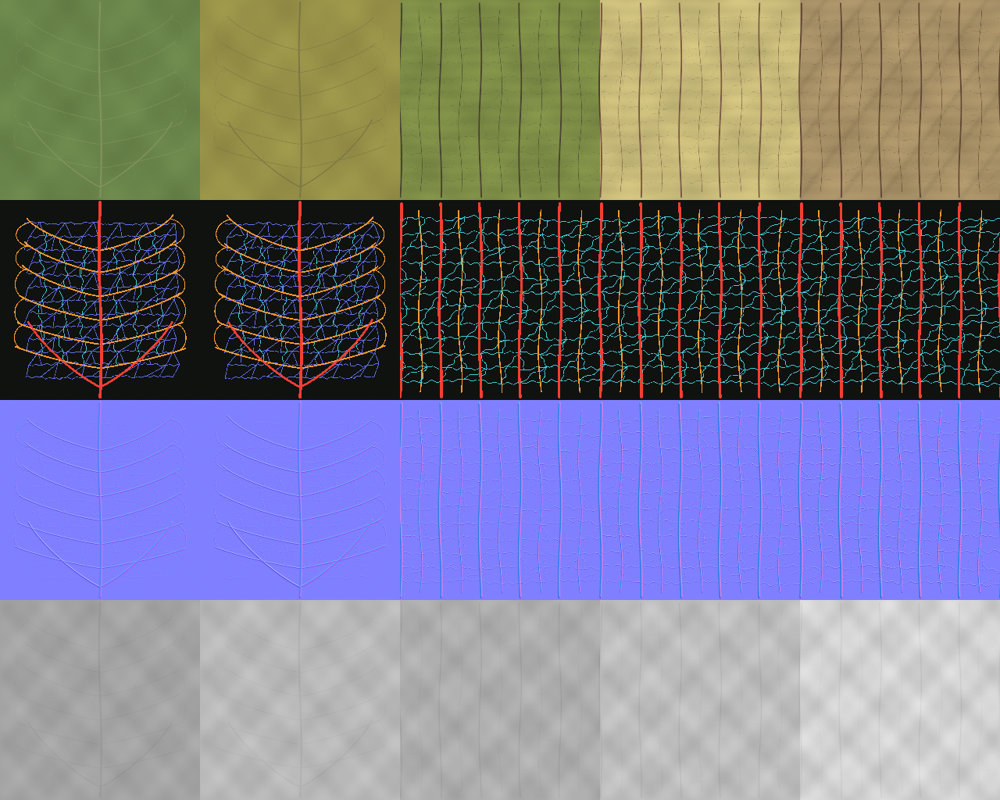

Columnas: `leaf_healthy`, `leaf_senescent`, `calyx_green`,
`calyx_straw`, `calyx_dry`. Filas: albedo, orden de venación, normal,
rugosidad.

## Mapas por conjunto

### leaf_healthy

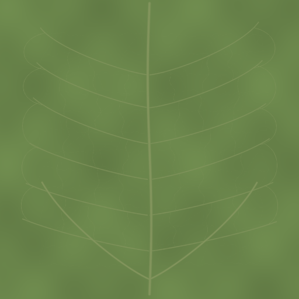 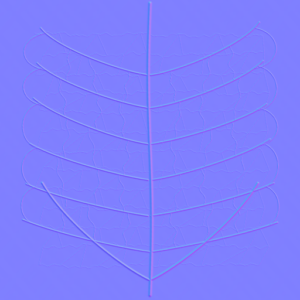

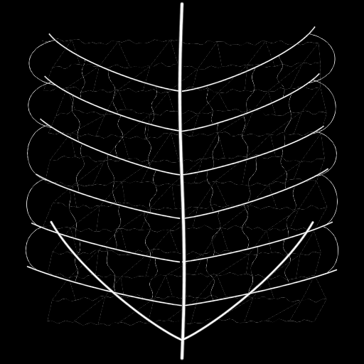 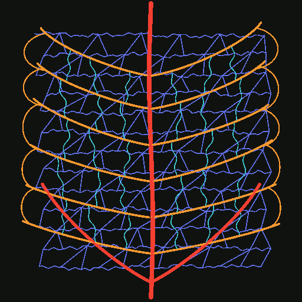

### leaf_senescent

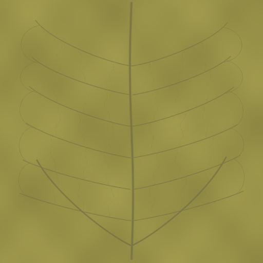 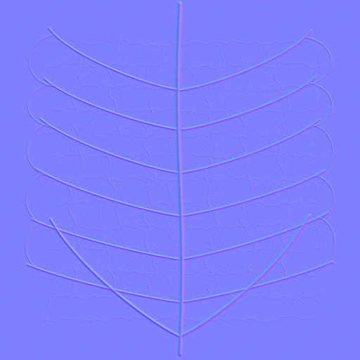

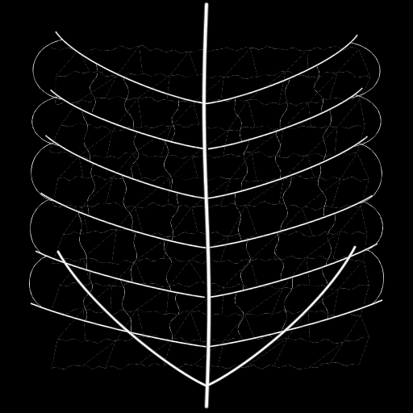 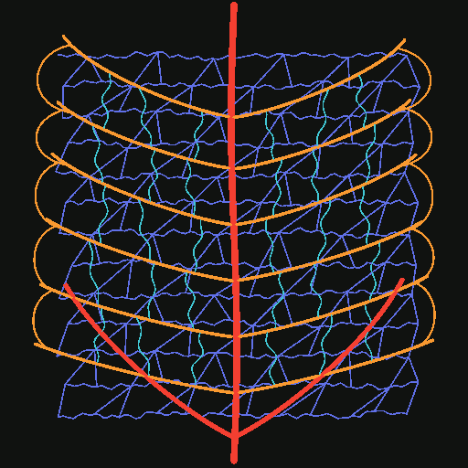

### calyx_green

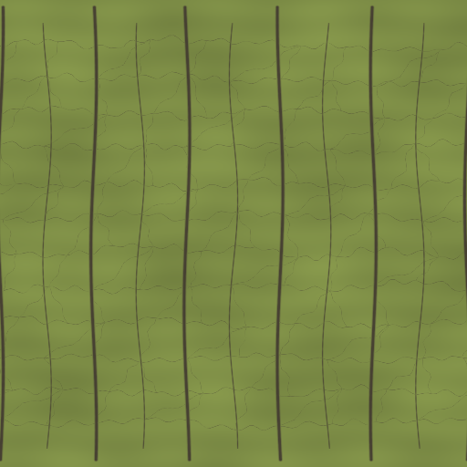 

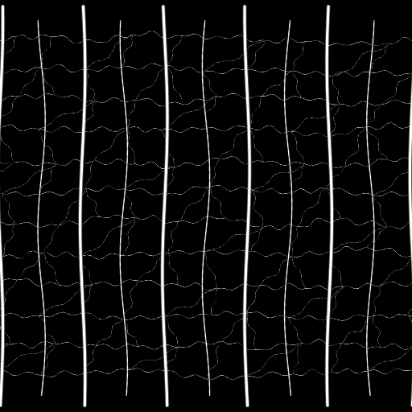 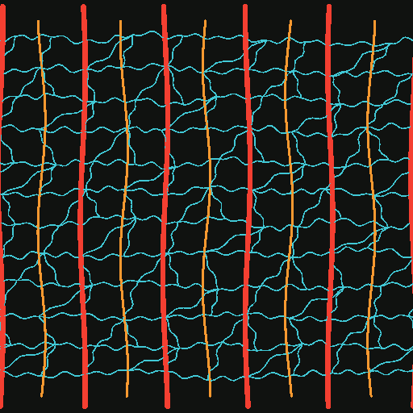

### calyx_straw

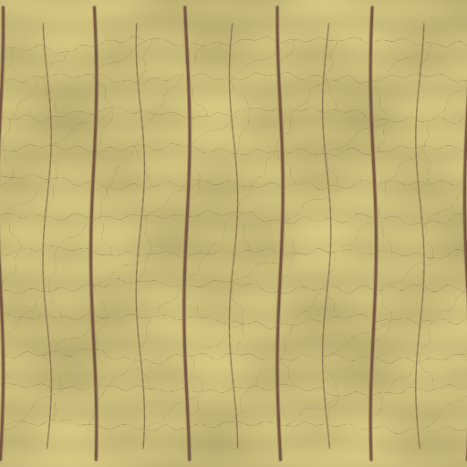 

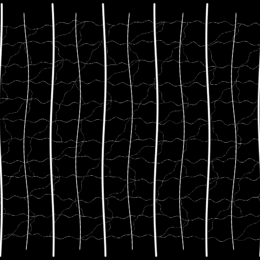 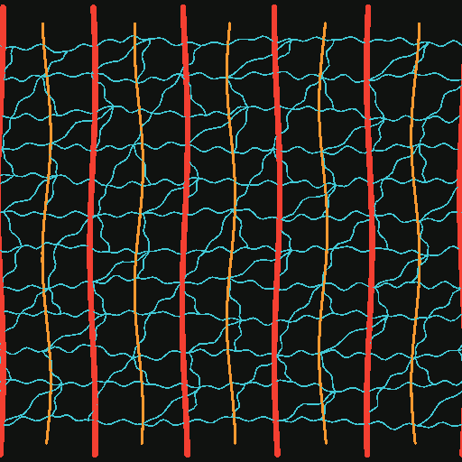

### calyx_dry

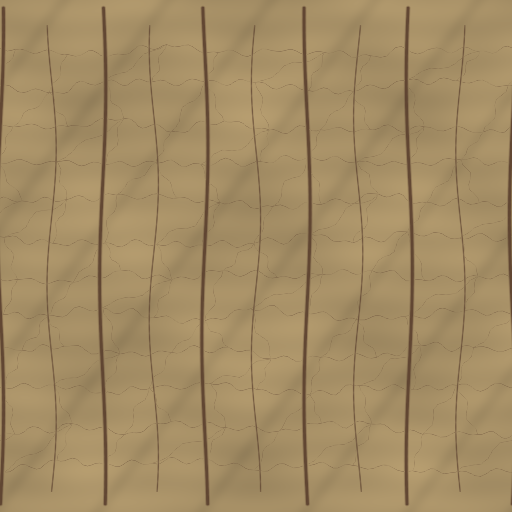 

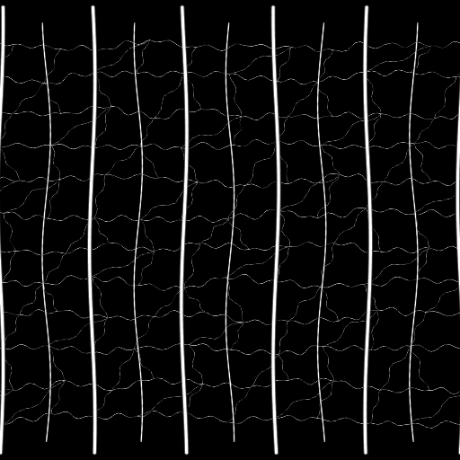 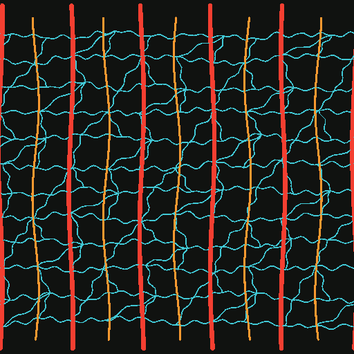

## Regeneración

```powershell
python scripts/generate_texture_assets.py --seed 1701 --resolution 512
```

Los parámetros, estados de evidencia y hashes SHA-256 están en
`manifest.json`.
