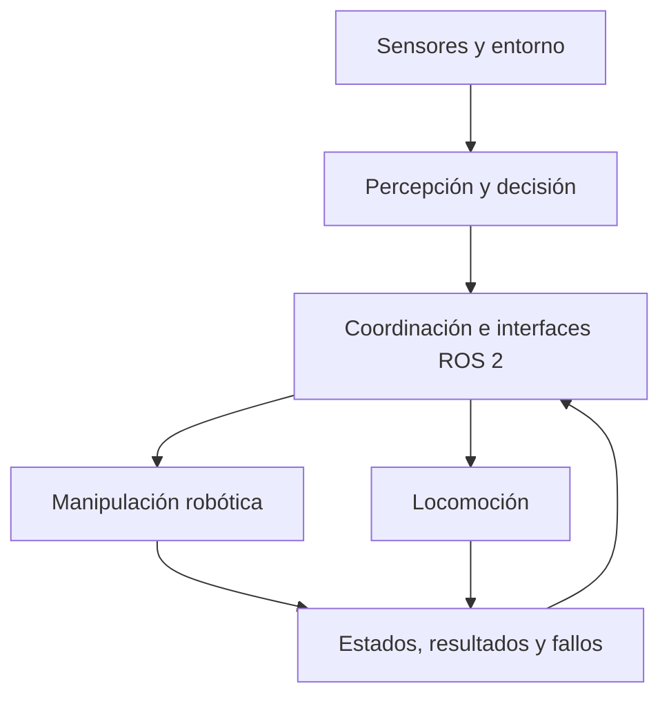
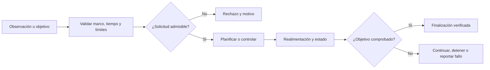

<div align="center">

# PhysalisHarvest

### Selective Cape Gooseberry Harvesting Robot

**Percepción y decisión · Manipulación robótica · Locomoción móvil · Integración ROS 2**


[](https://github.com/amayadiegoalejandro05/PhysalisHarvest/actions/workflows/ci.yml)

**Semillero de investigación SEIMA · Universitaria Agustiniana · Colombia**

[Arquitectura](#arquitectura-general) · [Subsistemas](#tres-subsistemas-un-robot) · [ROS 2](#integración-y-contratos-ros-2) · [Experimentación](#metodología-de-desarrollo-y-validación) · [Comenzar](#puesta-en-marcha) · [Contribuir](CONTRIBUTING.md)

</div>

---

## Propósito

**PhysalisHarvest** es un macroproyecto de ingeniería mecatrónica orientado al desarrollo de un robot para la **cosecha selectiva de uchuva (*Physalis peruviana* L.)**. Su diseño distribuye responsabilidades entre tres subsistemas que deben integrarse: **percepción y decisión**, **brazo manipulador** y **locomoción**. ROS 2 constituye la capa propuesta de intercambio de información y coordinación; Gazebo sirve como entorno de simulación y experimentación, separado de las mediciones físicas.

El reto no se limita a detectar una fruta: el sistema debe razonar sobre **dónde se encuentra un objetivo**, **cómo situar el robot para alcanzarlo** y **qué movimientos del manipulador pueden realizarse de manera segura**, manteniendo un intercambio consistente de objetivos, estados y rechazos.

> [!IMPORTANT]
> Este README presenta la **arquitectura objetivo del macroproyecto**, no una declaración de cosecha autónoma ya conseguida. Las capacidades se incorporan y se evalúan progresivamente; la existencia de un módulo, rama o diagrama no constituye una prueba de funcionamiento físico.

## Contenido

- [Arquitectura general](#arquitectura-general)
- [Tres subsistemas, un robot](#tres-subsistemas-un-robot)
- [Integración y contratos ROS 2](#integración-y-contratos-ros-2)
- [Banco experimental de coordenadas: chasis 2WD](#banco-experimental-de-coordenadas-chasis-2wd)
- [Tecnologías y plataformas](#tecnologías-y-plataformas)
- [Metodología de desarrollo y validación](#metodología-de-desarrollo-y-validación)
- [Puesta en marcha](#puesta-en-marcha)
- [Organización del repositorio](#organización-del-repositorio)
- [Colaboración y ramas](#colaboración-y-ramas)
- [Alcance y limitaciones](#alcance-y-limitaciones)
- [Documentación y antecedentes](#documentación-y-antecedentes)

---

## Arquitectura general

El robot se concibe como un sistema de módulos **interdependientes pero desacoplados**: cada subsistema debe poder desarrollarse y ensayarse mediante entradas controladas y receptores de prueba antes de integrar el conjunto.



**Figura 1. Arquitectura funcional propuesta.** Las flechas indican intercambio lógico de información, no tópicos ya implementados ni autorizaciones implícitas para mover motores.

| Capa | Pregunta que resuelve | Resultado esperado |
|---|---|---|
| **Percepción y decisión** | ¿Qué objetivo existe, dónde está y es abordable? | Observación 3D, decisión de selección y propuesta de aproximación |
| **Manipulación** | ¿Puede el brazo alcanzar el objetivo de forma segura? | Evaluación de factibilidad, trayectoria ejecutable si corresponde y estado del manipulador |
| **Locomoción** | ¿Dónde debe situarse la plataforma y cómo desplazarse? | Objetivo de posicionamiento, control de movimiento y estado de la base |
| **Integración ROS 2** | ¿Cómo intercambiar datos, restricciones y resultados sin ambigüedades? | Contratos, transformaciones de marcos, sincronización, confirmaciones y gestión de fallos |

La selección visual no autoriza un movimiento; el brazo y la plataforma deben validar sus condiciones de operación antes de actuar. La coordinación también debe contemplar objetivos rechazados, datos vencidos y transformaciones no disponibles.

## Tres subsistemas, un robot

### 01 · Percepción y decisión

<details open>
<summary><strong>Del sensor al objetivo geométrico</strong></summary>

Se estudia la adquisición RGB-D, la detección visual, la correspondencia imagen–profundidad y la obtención de coordenadas tridimensionales referidas a un marco documentado. La decisión debe considerar accesibilidad, obstáculos, calidad de los datos y criterios explícitos de selección.

**Salidas objetivo:** observaciones trazables, coordenadas con marco y tiempo, decisión aceptada/rechazada, y aproximación cartesiana **candidata** para su evaluación por el manipulador.

**Evaluación:** exactitud y dispersión de localización 3D frente a referencia independiente, profundidad válida, desempeño de detección, calidad de selección, latencia y razones de rechazo. Detectar el cáliz visible no equivale a estimar el centro de la baya, madurez ni punto de corte.

</details>

### 02 · Brazo manipulador

<details open>
<summary><strong>De la propuesta de objetivo al movimiento físicamente viable</strong></summary>

El subsistema de manipulación comprende modelado cinemático, espacio de trabajo, límites articulares, planificación, verificación de colisiones, control del brazo y posible integración de un efector final según el alcance y hardware que se aprueben.

**Salidas objetivo:** evaluación de factibilidad, aceptación o rechazo motivado, trayectoria validada para el actuador correspondiente, retroalimentación y resultado de la ejecución cuando exista.

**Evaluación:** factibilidad geométrica, cumplimiento de límites, separación frente a obstáculos, error de posicionamiento, tiempo de planificación, respuesta a cancelaciones y condiciones de parada. Una ruta cartesiana propuesta por percepción no demuestra que el brazo pueda ejecutarla.

</details>

### 03 · Locomoción

<details open>
<summary><strong>Del objetivo de desplazamiento al posicionamiento de la plataforma</strong></summary>

La locomoción aborda el movimiento de la base, la disponibilidad del sistema, los comandos de accionamiento, el posicionamiento y, de implementarse, la estimación de pose y la planificación de recorridos. Debe coordinar sus desplazamientos con la percepción y con el espacio seguro de operación del manipulador.

**Salidas objetivo:** desplazamiento o posicionamiento solicitado, estado de movimiento, rechazos por restricciones, estimación de pose cuando exista y confirmación de llegada basada en una medición verificable.

**Evaluación:** error de llegada a objetivos, repetibilidad, respuesta a parada, pérdida de comunicación, tiempo de desplazamiento y capacidad de rechazo. Sin una referencia posicional o realimentación adecuada, el giro de las ruedas no demuestra que la base haya alcanzado una coordenada.

</details>

Los tres subsistemas son **componentes centrales del macroproyecto**. Sus alcances experimentales, responsables y calendarios pueden diferir; ninguno debe aparecer como accesorio del otro en la documentación general.

## Integración y contratos ROS 2

ROS 2 permite conectar procesos distribuidos, intercambiar datos tipados y observar estados. La integración debe distinguir una **observación**, una **propuesta**, una **solicitud de movimiento** y una **ejecución confirmada**. Las interfaces entre equipos permanecen sujetas a aprobación; consultar [contratos ROS 2 propuestos](docs/interfaces/contratos-ros2.md).



**Figura 2. Secuencia lógica de validación y realimentación.** Representa un criterio de diseño; no afirma que exista ya un controlador que la implemente.

| Elemento del contrato | Consideración necesaria |
|---|---|
| Tipo y semántica | `PointStamped`, `PoseStamped`, acción o mensaje personalizado **según el caso y aprobación** |
| Coordenadas | Metros; ejes y origen definidos explícitamente |
| Referencias | `frame_id`, transformaciones TF y disponibilidad temporal |
| Tiempo | Instante de adquisición, sello de publicación, vigencia y latencia |
| Comunicación | QoS, secuencia o ID, pérdida de enlace y timeout |
| Seguridad | Validación por el receptor, límites, rechazo, cancelación y parada |
| Confirmación | Recepción (`ACK`), ejecución y llegada comprobada son hechos diferentes |

No se asumen nombres definitivos de tópicos, paquetes de mensajes ni controladores. Una prueba con coordenadas ficticias demuestra transporte de información únicamente hasta donde llegue su evidencia.

## Banco experimental de coordenadas: chasis 2WD

La rama [`feat/2WD`](https://github.com/amayadiegoalejandro05/PhysalisHarvest/tree/feat/2WD) se reserva para un **banco de integración físico**: comprobar que un sistema receptor **recibe una coordenada objetivo a través de ROS 2**, la valida y transforma en órdenes para los actuadores de un chasis de dos ruedas motrices, con la finalidad de **desplazar la plataforma hacia esa posición**.

El ensayo debe cerrar la cadena de extremo a extremo:

**Objetivo publicado en ROS 2 → receptor → validación de coordenadas y referencia → control de movimiento → actuadores y ruedas → medición de posición alcanzada → estado o rechazo.**

En un chasis terrestre, un destino espacial recibido debe traducirse a un objetivo compatible con el plano de movimiento (normalmente posición **X–Y** y, cuando aplique, orientación), usando transformaciones y convenciones documentadas. Inicialmente pueden publicarse objetivos ficticios para aislar la comunicación; posteriormente se podrá estudiar el enlace con un módulo real de percepción.

**Criterio central:** recibir un mensaje, girar motores o confirmar un comando **no demuestra que el chasis llegó a la coordenada**. Para declarar llegada se necesita una referencia independiente o un sistema de localización caracterizado, además de tolerancias, límites, gestión de pérdida de comunicación y parada segura. El chasis 2WD es un **banco de validación del flujo ROS 2 → actuación**, no el cuarto subsistema ni una demostración anticipada de navegación autónoma.

### Uso del banco

Desde PowerShell en la raíz, abre la consola Windows en modo desconectado:

```powershell
& .\.venv-astra\Scripts\python.exe -B .\firmware\bench_2wd\tools\consola_2wd.py --vista-previa
```

Para operar el banco, usa el mismo comando sin `--vista-previa` y sigue la [secuencia de la consola](ros2_ws/src/robot_locomocion/bench_2wd_drv8833/README.md#consola-windows). El [procedimiento DRV8833](ros2_ws/src/robot_locomocion/bench_2wd_drv8833/README.md) cubre la instalación desde un clon, el cableado, el firmware ESP32 y los comandos para dirigir el banco al primer ArUco válido observado. Consulta el [contrato ROS 2 y serial](docs/interfaces/bench-2wd-drv8833.md) y el [diagnóstico RGB-D](ros2_ws/src/robot_locomocion/bench_2wd/README.md). La ruta de varios marcadores queda pendiente de prueba física. Los [ensayos históricos del banco](firmware/bench_2wd/README.md) conservan sus resultados y límites.

## Tecnologías y plataformas

| Dominio | Referencia de trabajo | Función prevista |
|---|---|---|
| Middleware | **ROS 2 Jazzy** | Intercambio de objetivos, estados y diagnósticos |
| Simulación | **Gazebo** | Ensayos virtuales, control de escenarios y análisis de comportamiento |
| Visión | **RGB-D, OpenCV, modelos de detección** | Adquisición de imágenes, localización geométrica y decisión |
| Robótica | **TF2, geometría, cinemática y planificación** | Transformaciones, comprobación de movimientos y coordinación |
| Sistemas embebidos | **Controladores y drivers según hardware confirmado** | Interfaz con sensores, actuadores y ruedas |
| Desarrollo | **Python/C++ según cada paquete** | Algoritmos, nodos y pruebas reproducibles |
| Calidad | **GitHub Actions y verificadores locales** | Revisión estática, tests disponibles y trazabilidad |

Las tecnologías de referencia no significan que todos los paquetes, dispositivos, SDK o controladores estén disponibles o integrados en cada equipo. Cada subsistema documentará las versiones y dependencias **efectivamente utilizadas**.

## Metodología de desarrollo y validación

El proyecto adopta **integración incremental por subsistema**. La demostración completa depende de que cada módulo entregue información semánticamente definida, maneje fallos y permita reproducir sus resultados.

| Línea de trabajo | Desarrollo incremental | Evidencia requerida |
|---|---|---|
| **Percepción** | Captura, calibración, localización 3D, accesibilidad y selección | Datos, referencia independiente, error/dispersiones, detecciones, rechazos y tiempo |
| **Manipulación** | Modelado, cinemática, factibilidad, trayectorias, ejecución segura | Configuración, límites, colisiones, error de posición, fallos y estados |
| **Locomoción** | Accionamiento, comunicación, posicionamiento, control y planificación | Referencia de posición, error de llegada, repetibilidad, paradas y logs |
| **Integración** | Contratos ROS 2, pruebas productor–consumidor, coordinación y simulación | Frames, unidades, timestamps, QoS, trazas, escenarios y casos de fallo |

Los experimentos se clasifican explícitamente como `PROYECTADO`, `IMPLEMENTADO`, `OBSERVADO_EN_SIMULACIÓN`, `MEDIDO_FÍSICAMENTE`, `VALIDADO` o `PENDIENTE`. Para reclamar `VALIDADO` debe existir un criterio de aceptación definido y evidencia reproducible; una CI verde o una captura de Gazebo no son suficientes.

### Principios experimentales

- **Referencia independiente:** comparar posiciones y resultados con mediciones que no alimenten la decisión del algoritmo.
- **Reproducibilidad:** guardar versiones de software, SHA, hardware, configuración, entradas, semillas cuando correspondan, registros y condiciones de ensayo.
- **Seguridad:** establecer límites, habilitación explícita, watchdog y parada accesible antes de energizar actuadores.
- **Separación de entornos:** distinguir datos físicos, datos sintéticos, Gazebo y reproducción de registros; la verdad interna del simulador no equivale a percepción autónoma.
- **Resultados completos:** documentar éxitos, fallos, abstenciones, pérdidas de comunicación y casos indeterminados.

## Puesta en marcha

### Clonar el proyecto

```bash
git clone https://github.com/amayadiegoalejandro05/PhysalisHarvest.git
cd PhysalisHarvest
git status --short --branch
git branch -a
```

### Ejecutar las verificaciones disponibles

En PowerShell con Python disponible:

```powershell
python scripts/check_repository.py
python scripts/check_git_context.py --target main
python -m unittest discover -s tests -p "test_*.py" -v
```

En Ubuntu o WSL 2, utilizando el intérprete correspondiente:

```bash
python3 scripts/check_repository.py
python3 scripts/check_git_context.py --target main
python3 -m unittest discover -s tests -p 'test_*.py' -v
```

Estos comandos verifican estructura, contexto Git y pruebas incluidas. **No prueban que el robot esté operando.** El comprobador de Git usa referencias locales; `git fetch origin` debe realizarse previamente si se requiere comparar el estado remoto actual y existe autorización.

### Entorno ROS 2

Cuando un subsistema incorpore paquetes ROS 2 reales con `package.xml` y dependencias declaradas, su compilación y pruebas se ejecutarán desde `ros2_ws` en un entorno compatible. Antes de usar `colcon`, confirma SO, ROS, dependencias y disponibilidad de paquetes; consulta [entorno reproducible](docs/entorno-reproducible.md).

La [CI](.github/workflows/ci.yml) evalúa comprobaciones estáticas; la [puerta ROS aislada](.github/workflows/ros-gate.yml) se ejecuta cuando cambian sus scripts. Mientras `ros2_ws/src` carezca de manifiestos, la compilación y las pruebas ROS 2 del robot se informan como **SKIP**, aunque el workflow termine con éxito.

## Organización del repositorio

```text
PhysalisHarvest/
├── .github/                        # Workflows y plantilla de PR
├── AGENTS.md                       # Reglas técnicas de agentes
├── CONTRIBUTING.md                # Contribuciones, ramas y revisión
├── README.md                      # Visión general del macroproyecto
├── docs/
│   ├── arquitectura/              # Arquitectura y decisiones
│   ├── interfaces/                # Propuestas y contratos ROS 2
│   ├── integracion/               # Coordinación entre equipos
│   ├── pruebas/                   # Verificación local y CI
│   └── entorno-reproducible.md
├── ros2_ws/src/
│   ├── robot_percepcion_decision/  # Visión y decisión
│   ├── robot_brazo/               # Manipulación
│   ├── robot_locomocion/          # Locomoción
│   └── robot_interfaces/          # Interfaces compartidas futuras
├── simulacion/
│   ├── gazebo/
│   └── modelos/
├── hardware/
│   ├── brazo/
│   └── locomocion/
├── firmware/
├── scripts/                       # Comprobadores y utilidades CI
└── tests/                         # Pruebas disponibles
```

Las carpetas muestran áreas de responsabilidad; pueden existir sin un paquete ROS funcional. Los detalles y evidencias de cada subsistema deben residir en sus propios recursos y PR, evitando convertir este README general en una bitácora particular.

## Colaboración y ramas

| Rama permanente | Responsabilidad |
|---|---|
| `main` | Base compartida e integración revisada |
| `feat/vision` | Percepción y decisión |
| `feat/arm` | Manipulación |
| `feat/locomotion` | Locomoción |
| `feat/2WD` | Banco experimental de recepción de coordenadas ROS 2 y actuación móvil |

Los cambios normales se proponen desde ramas temporales hacia la rama del área. Los cambios a interfaces, documentación global, CI o normas se proponen hacia `main` y luego se sincronizan con los subsistemas. Consultar [CONTRIBUTING.md](CONTRIBUTING.md) y [AGENTS.md](AGENTS.md) para convenciones, revisiones y seguridad.

## Alcance y limitaciones

- El **objetivo final del macroproyecto** es integrar percepción, manipulación y locomoción para investigar cosecha selectiva de uchuva. La cosecha física completa **no se da por demostrada**.
- Los nombres de mensajes, tópicos, servicios, acciones y marcos compartidos aún requieren acuerdo entre equipos.
- La percepción entrega propuestas geométricas; la validación de movimientos corresponde a los subsistemas actuadores y a los responsables de integración.
- Alcanzar coordenadas con una base móvil requiere conocer o estimar su pose y comprobar el resultado mediante una referencia adecuada; la comunicación ROS 2 por sí sola no satisface ese requisito.
- Las pruebas de simulación y las pruebas físicas tienen alcances distintos y deben registrarse por separado.
- La política de licencias del software, modelos, datos y recursos de terceros requiere decisiones de sus titulares antes de distribuir componentes externos.

## Documentación y antecedentes

| Recurso | Descripción |
|---|---|
| [AGENTS.md](AGENTS.md) | Política técnica de desarrollo, seguridad y evidencia |
| [CONTRIBUTING.md](CONTRIBUTING.md) | Flujo Git, PR, checks y coordinación entre equipos |
| [Arquitectura](docs/arquitectura/README.md) | Decisiones y límites del sistema |
| [Contratos ROS 2 propuestos](docs/interfaces/contratos-ros2.md) | Acuerdos futuros entre productores y consumidores |
| [Integración](docs/integracion/README.md) | Responsabilidades y condiciones para acoplar módulos |
| [Verificación y CI](docs/pruebas/ci.md) | Qué prueban y qué omiten los checks |
| [Entorno reproducible](docs/entorno-reproducible.md) | Comprobaciones y requisitos del entorno |
| [Registro de uso de IA](docs/AI_USAGE.md) | Trazabilidad de asistencia de IA |

**Investigación institucional:** macroproyecto Robot Cosechador, semillero SEIMA, Universitaria Agustiniana. Los equipos documentarán la autoría y la evidencia de sus respectivas contribuciones sin atribuir resultados no comprobados al proyecto integrado.

---

<div align="center">

**PhysalisHarvest**

*Perceive · Manipulate · Move · Validate*

**Una plataforma robótica modular para investigación en cosecha selectiva de uchuva.**

</div>
