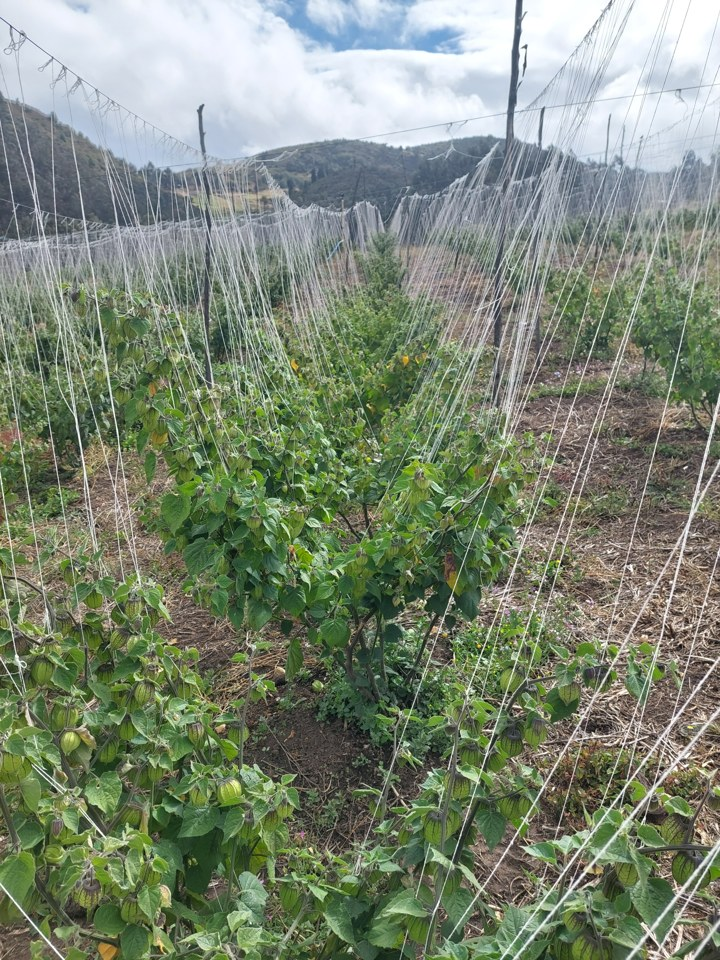
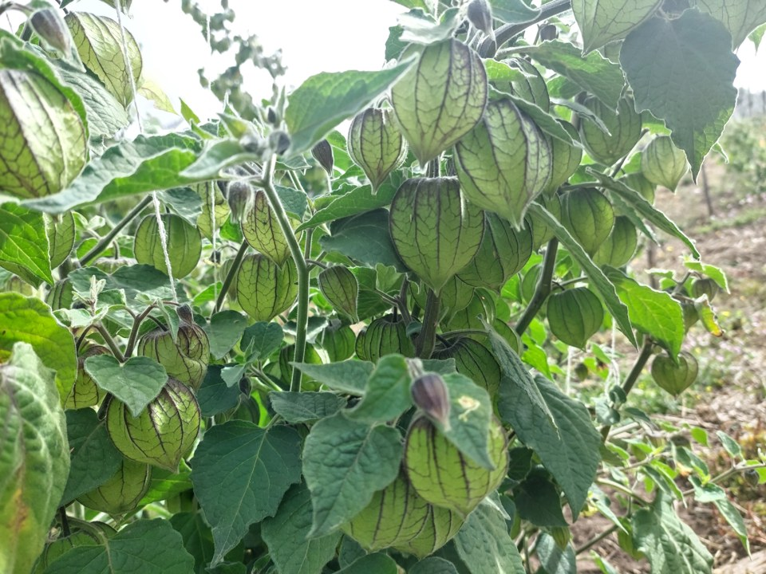
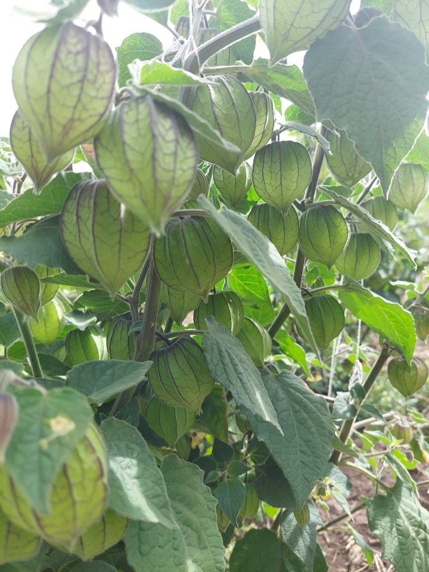
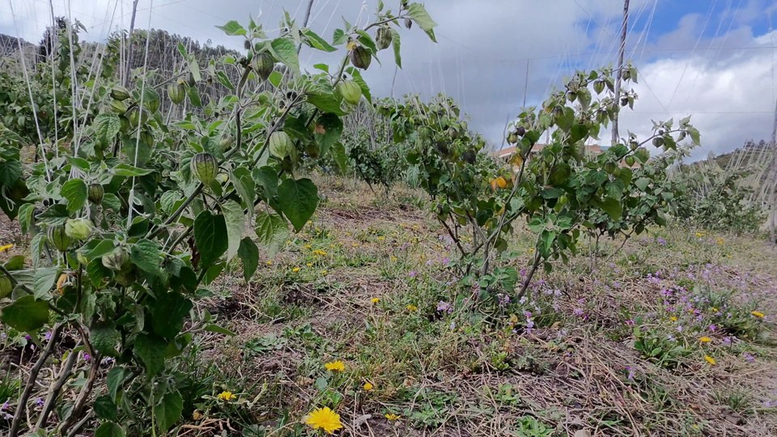
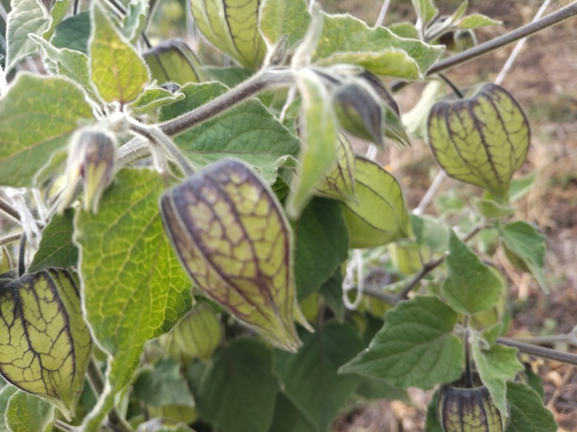
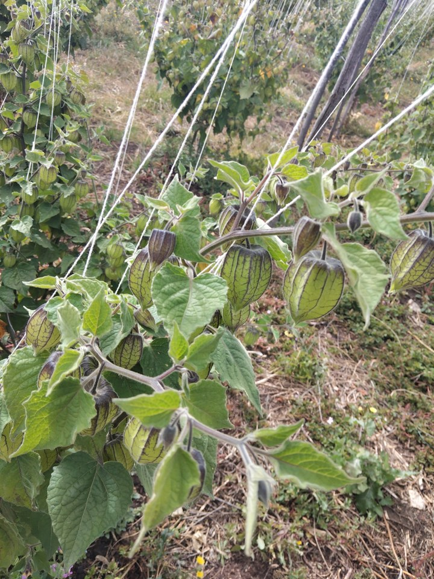
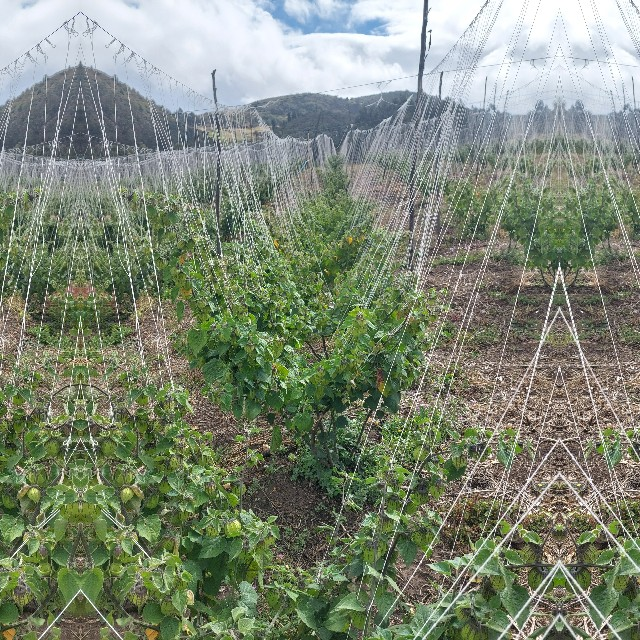
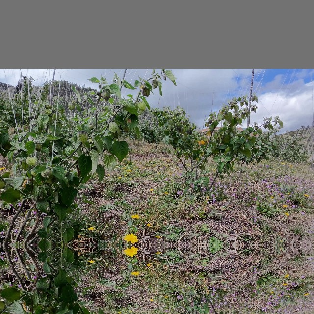

# Nuevas imágenes: estado y decisiones para continuar

La entrega local vigente contiene **488 imágenes sin etiquetar**: 360 frames y 128 fotografías. Se eligieron por diversidad visual, sin una meta numérica final. Es una selección **provisional**, pendiente de revisión humana de grupos de captura y cobertura de capachos pequeños. No se entrenó ni evaluó un detector con esta entrega.

Este informe permite continuar la discusión desde Chat sin disponer de los videos ni del dataset local completo. El repositorio incluye ocho vistas ilustrativas comprimidas y un manifiesto de procedencia; no constituyen una muestra estadística ni un conjunto para entrenamiento. Los derechos de las capturas no se transfieren por la licencia MIT del código.

## Entrega actual

| Split conservado | Imágenes | Porcentaje |
|---|---:|---:|
| train | 337 | 69,06 % |
| val | 73 | 14,96 % |
| test | 78 | 15,98 % |
| Total | 488 | 100 % |

Siguen representados los 37 grupos propuestos y los 23 orígenes de video presentes en v5. Estos grupos **no son todavía unidades de independencia confirmadas**. Ninguna imagen retenida cambió de split. Se priorizó mantener grupos completos sobre recuperar porcentajes exactos de 70/15/15.

Archivos locales, fuera de Git:

- `outputs/new_real_dataset/captura_20260912_v6/images/`: resolución original y orientación corregida.
- `outputs/new_real_dataset/captura_20260912_v6/images_640x640/`: versión con relleno gris.
- `outputs/new_real_dataset/captura_20260912_v6_espejo/originals/`: 488 copias exactas de los originales de entrega.
- `outputs/new_real_dataset/captura_20260912_v6_espejo/images_640x640/`: 488 PNG, proporción conservada, relleno lateral e inferior en espejo y superior gris 114.

Ambos formatos mantienen `train/val/test`. No se crearon etiquetas YOLO vacías. Las versiones previas y los candidatos reservados siguen disponibles localmente.

## Filtros aplicados y carácter tentativo

| Etapa | Selección | Criterio y limitación |
|---|---:|---|
| Inventario | 667 fotos, 26 videos | Extracción inicial y sondeos de cambios; 7615 candidatos. Sin mezclar el histórico. |
| v2 | 6438 | Propuesta inicial por similitud y revisión exploratoria. |
| v3 | 6425 | Exclusión de 13 fotos con flexómetro. Se revisaron las fotos; en videos se revisó una muestra, no todos los frames. |
| v4 | 5004 | Reservas por correspondencias ORB, solapamiento y semejanza fotométrica. El criterio geométrico resultó demasiado conservador para reducir tomas visualmente repetidas. |
| v5 | 2400 | Presupuesto solicitado, cuotas por origen y diversidad de apariencia; conservaba todas las 652 fotos y aún demasiadas ráfagas. |
| v6 | 488 | Revisión visual de las 2400 imágenes en hojas de contacto, segunda pasada sobre 606 representantes y ampliación de pares consecutivos parecidos. Sin cuotas ni objetivo de cantidad. |

En v4 los umbrales fueron heurísticos: diferencia de escala 0,15; solapamiento mínimo 0,65; 20 inliers; fracción mínima 0,30; error fotométrico alineado máximo 28 y cobertura de cuatro celdas. No son umbrales científicos validados ni garantizan identidad de escena. El código y sus pruebas quedan en el repositorio.

En v6 la segunda pasada dejó 496; la revisión ampliada de 36 pares consecutivos priorizados por apariencia retiró otros ocho. Se comprobaron las ocho nuevas adyacencias. Los 1912 elementos retirados respecto a v5 son reservas recuperables por redundancia o escasa aportación visual adicional, **no negativos ni duplicados exactos confirmados**. No se descartó automáticamente por un umbral global de nitidez, que podría perjudicar los planos lejanos.

La revisión visual del asistente usó miniaturas y ampliaciones de estas; no inspeccionó todos los originales a resolución completa. Se conservaron diferencias de distancia aparente, perspectiva, iluminación y oclusión. Esta selección puede revisarse; conservar todos los grupos no demuestra por sí solo conservar toda la diversidad biológica.

## Ejemplos para discutir

Las categorías de encuadre siguientes son descripciones ilustrativas, no etiquetas de tamaño de instancia ni de madurez. La procedencia, IDs, grupos y splits se encuentran en el [manifiesto de ejemplos](assets/nuevo_dataset_2026-09-23/manifest.json).

| Plano general conservado | Detalle conservado |
|---|---|
|  |  |

La siguiente toma quedó en reserva por su similitud visual con el detalle anterior. Es un ejemplo de una decisión tentativa de curación, no una declaración de igualdad píxel a píxel.

| Perspectiva baja | Capachos con oclusión | Plano medio |
|---|---|---|
|  |  |  |

## Relleno solicitado: variante experimental

Las copias de 640 × 640 se generaron con redimensionamiento proporcional `INTER_LINEAR`, contenido centrado y `BORDER_REFLECT_101` a los lados y abajo donde hace falta relleno. La franja superior permanece gris. No hay recortes ni superresolución. Las ilustraciones siguientes son JPEG reducidos de los PNG locales.

| Espejo lateral | Espejo inferior y gris superior |
|---|---|
|  |  |

El espejo puede repetir capachos y producir objetos artificiales en los bordes. No representa datos nuevos ni mejora demostrada del detector. Antes de entrenar hay que decidir si esta variante se utiliza y cómo se tratarán los objetos reflejados en las etiquetas; transformar solo las cajas del área original puede dejar reflejos visibles sin anotación. Se recomienda conservar el etiquetado base sobre los originales y comparar las variantes de preprocesamiento mediante entrenamiento/validación, sin elegirlas por los resultados del test.

## Revisiones necesarias para continuar

1. Confirmar grupos por área/planta, relaciones entre fotos y videos y copias recomprimidas. Si aparece una relación entre splits, corregir grupos completos en una nueva versión antes de congelar.
2. Revisar a resolución completa presencia de capachos pequeños, medianos y grandes, permitiendo múltiples escalas y estados `sin_objetivo_visible` e `incierto`. Estas son categorías de selección, no clases de anotación. Acordar su criterio antes de contar cobertura; las cajas anotadas permitirán medir tamaños en píxeles.
3. Contar cobertura por escala y por grupos independientes en cada split. Recuperar reservas distintas si faltan tomas lejanas útiles; si no existen, planificar nueva captura. No duplicar imágenes para aparentar equilibrio.
4. Acordar política de anotación y de relleno en espejo. No inferir madurez por apariencia del capacho ni tratar una imagen sin etiquetas como negativa.
5. Congelar una versión tras resolver pendientes y reservar test para evaluación posterior. Una sola jornada no demuestra generalización entre fechas o fincas. La integración con el histórico sería otro experimento, con auditoría propia; el test histórico ya fue observado durante desarrollo.

## Evidencia disponible

La validación local aprobó hashes, dimensiones/orientación, correspondencia de los 488 originales y derivados con sus manifiestos, conservación de splits y ausencia de cruces entre grupos propuestos o duplicados exactos conocidos. Esto es integridad estructural, no prueba de independencia visual ni validación humana de escalas.

- [Registro exacto de selección v6](../reviews/real_dataset_visual_selection_2026-09-22.json): IDs retenidos/reservados y hash del manifiesto padre.
- [Historial de curación](curacion_nuevo_dataset_2026-09-22.md).
- [Protocolo para estudiantes y reproducción](../guides/nuevo_dataset_real.md).
- [Herramienta de curación](../../scripts/prepare_new_real_dataset.py), [reducción geométrica](../../scripts/reduce_video_redundancy.py), [selección por presupuesto v5](../../scripts/select_dataset_budget.py) y [exportación en espejo](../../scripts/export_mirror_dataset.py).

**Punto de partida para Chat:** revisar primero si los ejemplos y el criterio de reserva son adecuados; después definir revisión de escalas/grupos y política de anotación del relleno. No hace falta fijar otra cantidad de imágenes antes de esa evaluación.
